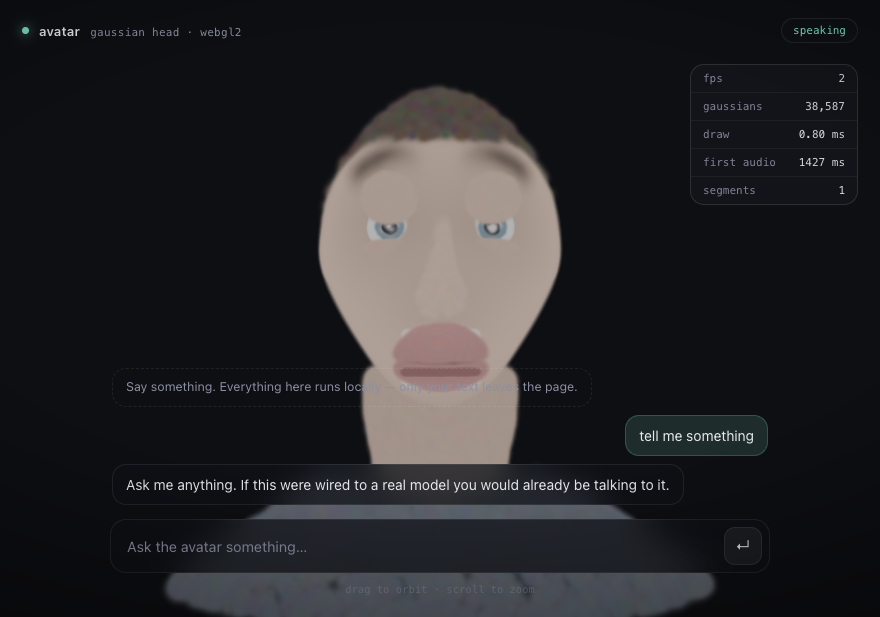

# realtime-avatar

A realtime, photoreal-*ish* head avatar that runs in a browser tab and talks back.
Text in → LLM reply → speech out → the face moves → everything renders client-side
as 3D Gaussians.

```
browser ──text──▶ server ──▶ LLM ──▶ TTS ──▶ audio → blendshapes ──▶ SSE
   ▲                                                                  │
   └──────────── WebGL2 gaussian splatting ◀── audio + 60 fps stream ──┘
```



The avatar is a static asset (~11 MB here) plus ~50 floats per frame. The server
never renders anything; the GPU cost per user is the user's own. That is the whole
point of the design.

## Quickstart

```bash
node server/server.mjs          # or: pnpm start
open http://127.0.0.1:8787/client/
```

No dependencies, no build step, no API key. On macOS the voice comes from `say`;
elsewhere it falls back to a synthetic babble so the pipeline still runs.

```bash
node tools/make-avatar.mjs      # rebuild assets/head.avtr from the procedural rig
node tools/preview.mjs --out preview.png --yaw 0.3 --preset talk
node tools/check-avatar.mjs assets/head.avtr
```

## What is real, what is a stand-in

| Piece | State | Swap for |
|---|---|---|
| Gaussian rig + WebGL2 renderer | real | — |
| Sorting, deformation, idle motion | real | — |
| Audio → blendshapes (`server/pipeline/a2e.mjs`) | classical DSP, works, not SOTA | LAM-A2E, or any streaming audio→expression model |
| TTS (`server/pipeline/tts.mjs`) | macOS `say` | ElevenLabs / Cartesia / CosyVoice |
| LLM (`server/pipeline/llm.mjs`) | canned text | any OpenAI-compatible endpoint (`LLM_PROVIDER=openai`) |
| Avatar asset (`tools/rig.mjs`) | procedural mannequin | LAM / Avat3r / UIKA reconstruction of a real person |

The last row is the one that matters for quality. Everything else is plumbing
around a `.avtr` file whose interface is: *N gaussians + a blendshape rig*.

## Use your own face

The shipped character is procedural so the repo runs with no downloads, no GPU and
no licence. To swap in a real one, you need a **rigged head mesh** — any GLB with
ARKit shape keys (a scan + Faceit in Blender, or an avatar SDK export):

```bash
node tools/import-mesh.mjs --list --in me.glb
node tools/import-mesh.mjs --in me.glb --out assets/me.avtr --count 40000
node tools/check-avatar.mjs assets/me.avtr
```

Then open `/client/?asset=/assets/me.avtr`. No code changes: channels are matched
by name, morph targets become per-Gaussian deltas, and the client keeps working.

Full walkthrough, including the channel mapping table: **[docs/ASSET.md](docs/ASSET.md)**.

### Or from one photo, with LAM

LAM reconstructs an animatable Gaussian head from a single image, but it needs an
NVIDIA GPU and returns FLAME-space Gaussians with no rig. `tools/import-lam.mjs`
reconstructs the rig: it binds every Gaussian to its nearest FLAME triangle and
pushes the 52 FLAME blendshape directions through those barycentric weights.

```bash
# on a rented GPU box
python tools/lam/export_avatar.py --lam-root /workspace/LAM \
  --model model_zoo/.../step_045500 --image me.jpg \
  --motion assets/sample_motion/export/Look_In_My_Eyes --out /workspace/me-export

# back on your machine
node tools/import-lam.mjs --in ~/Downloads/me-export --out assets/me.avtr
```

Step-by-step: **[docs/RUNBOOK-LAM.md](docs/RUNBOOK-LAM.md)**.

## Measured on this machine

| Stage | Time |
|---|---|
| First audio out (stub LLM) | **1.4 s** |
| TTS per sentence (`say`) | ~520 ms |
| Audio → blendshape frames (4 s of speech) | 12 ms |
| Deform 38k gaussians (CPU) | ~1 ms |
| Splat + sort | renderer-side, see `docs/ARCHITECTURE.md` |

Well under 16 ms of avatar work per frame. The latency you feel is LLM + TTS, not
the face.

## Layout

```
client/        app shell, WebGL2 splatter, rig, idle motion, audio clock
server/        static host + SSE orchestrator
server/pipeline/   llm · tts · audio→blendshapes · wav
shared/format.mjs  the .avtr container
tools/
  rig.mjs            procedural character
  import-mesh.mjs    GLB with ARKit shape keys -> .avtr
  import-lam.mjs     LAM FLAME-space Gaussians -> .avtr (re-binds the rig)
  arkit-map.mjs      ARKit 52 -> rig 16 channel mapping, shared by both
  lam/export_avatar.py   runs on the GPU box, dumps what the importer needs
  glb.mjs            dependency-free glTF reader + PNG decoder
  check-avatar.mjs   rig validator (CI-friendly)
  preview.mjs        software renderer, no GPU
  make-test-glb.mjs  synthetic rigged fixture for tests
assets/        head.avtr
docs/          architecture, asset pipeline
```

## Known gaps

- **Segment seams.** Each sentence is synthesised as it streams in, so if TTS is
  slower than playback there is a silence gap where the mouth snaps shut. Fix:
  clause-level chunking plus a small pre-synthesis buffer.
- **No visemes worth the name.** The DSP mapper tracks loudness and spectral
  centroid. It looks plausible; it is not lip-accurate.
- **Flat lighting.** Colours are baked SH-less; no relighting, no shadows.
- **38k gaussians at 11 MB.** Fine on desktop, wasteful on mobile. Quantise and
  prune (see CVPR'26 mobile avatar work) before shipping.
- **The importer is verified against a synthetic fixture**, not against every
  commercial GLB. `--list` plus `check-avatar` localises most surprises.
- **Gaze is shared between the eyes** — one `eyeLookX`, so no vergence. Split the
  channel in `tools/rig.mjs` if you need it.
- **`?static=1`** freezes the rig at rest — useful when you are debugging the asset.

## License

Scaffold code: do what you like. The character is procedural, so there is no
likeness to worry about.
