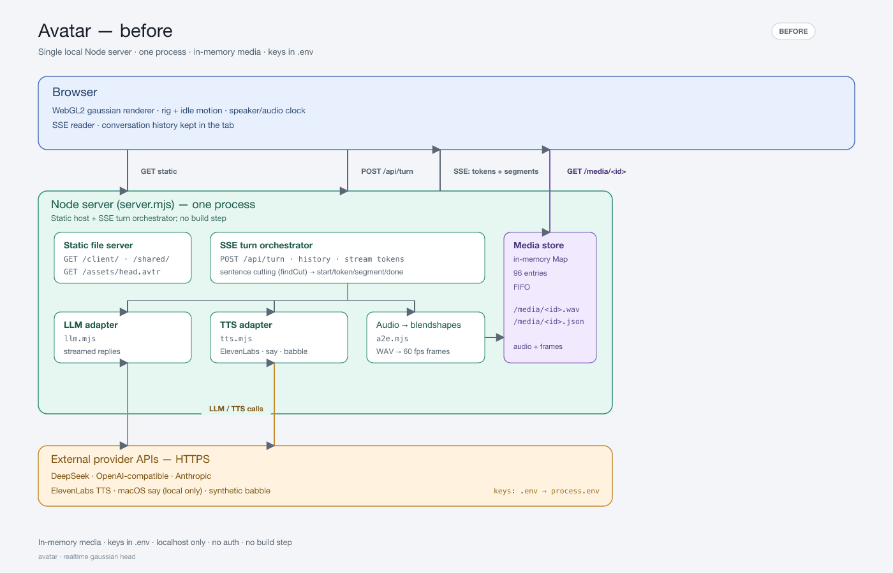
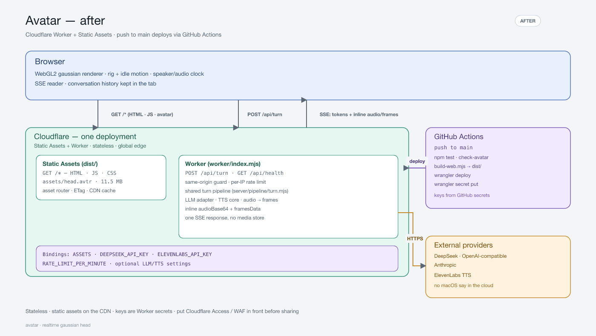

# Architecture: before and after

The local mode and the Cloudflare deployment run the same turn pipeline. The
difference is where static files come from, how generated media reaches the
browser, and where the provider keys live.

## Before — one local Node process



[SVG source](architecture-before.svg)

- `node server/server.mjs` serves the client, shared modules, avatars, `/api/*`,
  and `/media/*` from one process on one machine.
- `.env` is loaded into `process.env`; macOS `say` is available as a local TTS
  fallback.
- The turn orchestrator streams an LLM reply, cuts it into sentences, calls TTS,
  derives blendshape frames, and stores the WAV + frames in a 96-entry in-memory
  `Map`.
- The SSE `segment` event contains `/media/<id>.wav` and `/media/<id>.json` URLs;
  the browser makes a second request for each.
- No auth, no horizontal scaling, no shared state. A restart loses cached media.

## After — Cloudflare Worker + Static Assets



[SVG source](architecture-after.svg)

- `dist/` (built by `tools/build-web.mjs`) is served by Cloudflare's asset router
  at `/*`; only `/api/*` invokes the Worker.
- The Worker runs the same shared pipeline (`server/pipeline/turn.mjs`), with
  `tts-core.mjs` providing ElevenLabs and babble (no macOS `say` in the cloud).
- Audio and frames are inlined in the SSE event as `audioBase64` and
  `framesData`, so there is no media store and no second request.
- The Worker is stateless: rate-limit buckets and the TTS LRU are per-isolate
  caches only. Scale is more isolates.
- Provider keys are Worker secrets. GitHub Actions pushes them from GitHub
  secrets after `wrangler deploy`.

```
push to main
  └─ GitHub Actions
       ├─ npm test
       ├─ check-avatar.mjs
       ├─ build-web.mjs → dist/
       ├─ wrangler deploy
       └─ wrangler secret put (provider keys + config)
```

## Differences at a glance

| Concern | Before | After |
|---|---|---|
| Runtime | One Node process | Cloudflare Worker + asset router |
| Static files | Node static host | Cloudflare CDN/asset router |
| Public URL | `http://127.0.0.1:8787/client/` | `https://<worker>.<subdomain>.workers.dev` or custom domain |
| API | `POST /api/turn`, `GET /api/health` | Same paths, same SSE contract |
| Segment media | `/media/<id>.wav` + `.json` URLs | `audioBase64` + `framesData` inline |
| Media storage | 96-entry in-memory Map | None; stateless |
| Keys | `.env` → `process.env` | Worker secrets from GitHub secrets |
| TTS | ElevenLabs / macOS `say` / babble | ElevenLabs / babble |
| Deploy | Run the process yourself | Push to `main` |
| Scaling | One machine | Horizontal, isolated |
| Auth | None | Same-origin + best-effort rate limit; add Access/WAF |

The local topology is still the right development loop: `npm start` runs the
before diagram, and the same provider adapters/tests exercise the code that the
Worker bundles.
